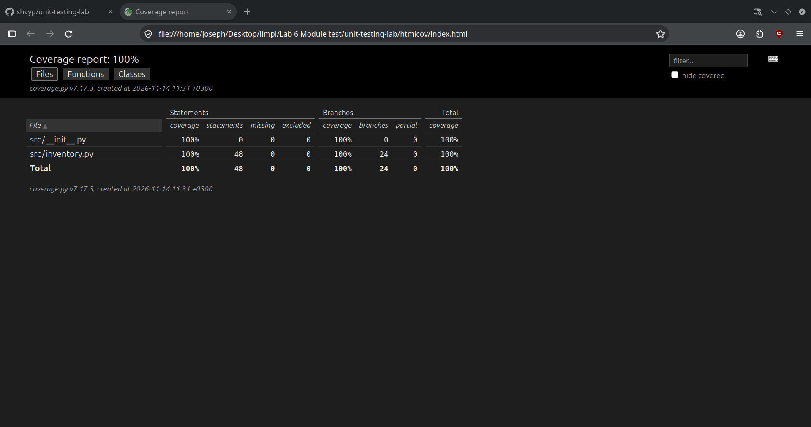

# Unit Testing Lab

Лабораторная работа по модульному тестированию.

## Запуск

```bash
python -m venv .venv
source .venv/bin/activate   # Windows: .venv\Scripts\activate
pip install -r requirements.txt
pytest
pytest --cov=src --cov-report=term-missing
```

## Отчёт о покрытии

Генерация HTML-отчёта о покрытии:

```bash
pytest --cov=src --cov-report=html
```

- **Текущий процент покрытия:** `100%` по строкам (48/48) и ветвям (24/24).
- **HTML-отчёт:** `htmlcov/index.html` (генерируется локально, не коммитится в Git согласно `.gitignore`).
- **Непокрытые участки:** отсутствуют — все строки и ветви модуля `src/inventory.py` покрыты тестами.


