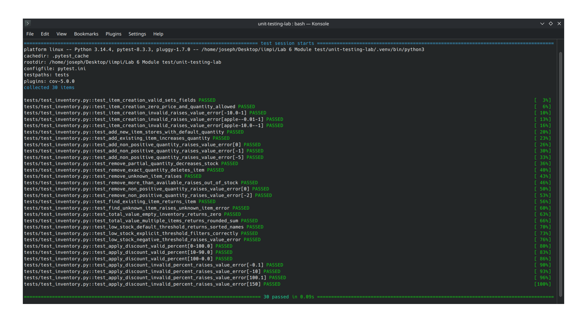
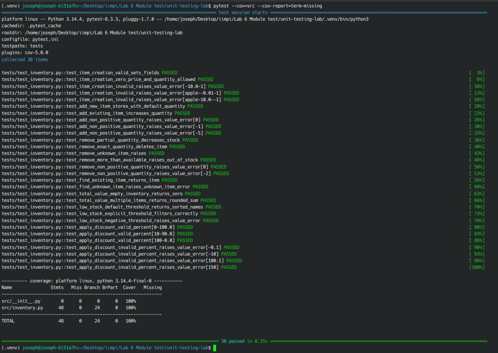
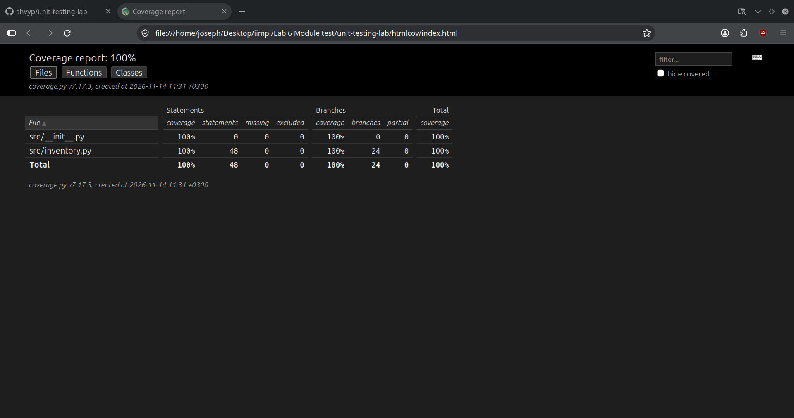

# Отчёт по лабораторной работе «Модульное тестирование»

**Тема:** Модульное тестирование. Написание, запуск тестов и измерение покрытия.  
**ФИО:** _[укажите ФИО]_  
**Группа:** _[укажите группу]_  
**Репозиторий:** https://github.com/shvyp/unit-testing-lab

---

## 1. Анализ модуля `src/inventory.py` (Шаг 2)

### Публичные сущности, входы, исключения и ветвления

1. **`Item(name: str, price: float, quantity: int = 0)`** (`__post_init__`)
   - Валидные входы: непустое `name`, `price >= 0`, `quantity >= 0`.
   - Граничные входы: `price = 0.0`, `quantity = 0`.
   - Невалидные входы и исключения: `name == ""` → `ValueError`; `price < 0` → `ValueError`; `quantity < 0` → `ValueError`.
   - Ветвления: 3 проверки `if` в `__post_init__`.

2. **`Inventory.add(item: Item, quantity: int = 1) -> None`**
   - Валидные входы: `Item`, `quantity > 0`.
   - Граничные входы: `quantity = 1` (значение по умолчанию и минимально допустимое).
   - Невалидные входы и исключения: `quantity <= 0` → `ValueError`.
   - Ветвления: `if quantity <= 0`; `if item.name in self._items` (увеличение существующего количества) / `else` (добавление новой позиции).

3. **`Inventory.remove(name: str, quantity: int = 1) -> None`**
   - Валидные входы: существующий `name`, `1 <= quantity <= item.quantity`.
   - Граничные входы: `quantity = 1`, `quantity == item.quantity` (обнуление и удаление позиции).
   - Невалидные входы и исключения: `quantity <= 0` → `ValueError`; `name not in self._items` → `UnknownItemError`; `item.quantity < quantity` → `OutOfStockError`.
   - Ветвления: `if quantity <= 0`, `if name not in self._items`, `if item.quantity < quantity`, `if item.quantity == 0`.

4. **`Inventory.find(name: str) -> Item`**
   - Валидные входы: существующий `name`.
   - Невалидные входы и исключения: отсутствующий `name` → `UnknownItemError`.
   - Ветвления: `if name not in self._items`.

5. **`Inventory.total_value() -> float`**
   - Входы: нет (зависит от состояния `self._items`).
   - Граничные случаи: пустой склад (`0`), дробные цены с округлением до 2 знаков.

6. **`Inventory.low_stock(threshold: int = 5) -> list[str]`**
   - Валидные входы: `threshold >= 0`.
   - Граничные входы: `threshold = 0`, дефолтный `threshold = 5`, позиция с `quantity == threshold`.
   - Невалидные входы и исключения: `threshold < 0` → `ValueError`.
   - Ветвления: `if threshold < 0`, фильтрация `i.quantity <= threshold`, сортировка `sorted(...)`.

7. **`Inventory.apply_discount(percent: float) -> float`**
   - Валидные входы: `0 <= percent <= 100`.
   - Граничные входы: `percent = 0`, `percent = 100`.
   - Невалидные входы и исключения: `percent < 0` или `percent > 100` → `ValueError`.
   - Ветвления: `if not 0 <= percent <= 100`.

### Чек-лист проверок (20 тестов / 30 тестовых прогонов)

1. Создание `Item` с валидными полями (`name`, `price`, `quantity`).
2. Создание `Item` с граничными значениями `price=0.0` и `quantity=0`.
3. Создание `Item` с пустым `name` → `ValueError`.
4. Создание `Item` с отрицательной `price` → `ValueError`.
5. Создание `Item` с отрицательным `quantity` → `ValueError`.
6. Добавление новой позиции на склад со значением `quantity` по умолчанию (`1`).
7. Добавление уже существующей позиции увеличивает её количество.
8. Добавление позиции с `quantity <= 0` (`0`, `-1`, `-5`) → `ValueError`.
9. Частичное списание позиции уменьшает остаток, позиция остаётся на складе.
10. Полное списание (`quantity == остатку`) удаляет позицию со склада.
11. Списание отсутствующей позиции → `UnknownItemError`.
12. Списание большего количества, чем есть на складе → `OutOfStockError`.
13. Списание с `quantity <= 0` (`0`, `-2`) → `ValueError`.
14. Поиск существующей позиции возвращает объект `Item`.
15. Поиск отсутствующей позиции → `UnknownItemError`.
16. Расчёт `total_value()` на пустом складе возвращает `0`.
17. Расчёт `total_value()` на складе с несколькими позициями (включая дробные цены) возвращает округлённую сумму.
18. `low_stock()` с порогом по умолчанию (`5`) возвращает отсортированный список имён позиций с остатком `<= 5`.
19. `low_stock()` с явным порогом (`1`, `0`) корректно фильтрует позиции; при `threshold < 0` → `ValueError`.
20. `apply_discount()` корректно применяет скидку для `0%`, `10%`, `100%` и выбрасывает `ValueError` при значениях вне `0..100`.

---

## 2. Код тестов и результаты запуска

Тесты находятся в файле [`tests/test_inventory.py`](tests/test_inventory.py).

Результат `pytest --cov=src --cov-report=term-missing --cov-report=xml --cov-report=html --cov-fail-under=85`:

```text
---------- coverage: platform linux, python 3.14.4-final-0 -----------
Name               Stmts   Miss Branch BrPart  Cover   Missing
--------------------------------------------------------------
src/__init__.py        0      0      0      0   100%
src/inventory.py      48      0     24      0   100%
--------------------------------------------------------------
TOTAL                 48      0     24      0   100%
Coverage HTML written to dir htmlcov
Coverage XML written to file coverage.xml

Required test coverage of 85% reached. Total coverage: 100.00%

============================== 30 passed in 0.23s ==============================
```

### Запуск `pytest -v`



### Консольный отчёт о покрытии (`--cov-report=term-missing`)



### HTML-отчёт о покрытии (`htmlcov/index.html`, 100%)



---

## 3. Анализ результатов (Шаг 7)

1. **Достигнутый процент покрытия:** `100%` по строкам (48 из 48) и `100%` по ветвям (24 из 24).
2. **Непокрытые строки:** отсутствуют.
3. **Наиболее ценные тесты:**
   - `test_remove_exact_quantity_deletes_item` — проверяет ветку удаления позиции при обнулении остатка (`del self._items[name]`).
   - `test_add_existing_item_increases_quantity` — проверяет ветку обновления остатка существующей позиции вместо перезаписи.
   - Параметризованные тесты граничных и невалидных входов (`Item`, `add`, `remove`, `apply_discount`) — выявляют корректность валидации исключений.
4. **Обнаруженные дефекты/особенности модуля:**
   - Все реализованные методы соответствуют своим докстрингам, падений тестов нет.
   - Потенциальная особенность проектирования: при вызове `add(item, quantity)` для уже существующего имени обновляется только `quantity`, а `price` нового объекта `Item` игнорируется; также при добавлении новой позиции мутируется поле `item.quantity` переданного объекта.
5. **Почему 100% покрытие не гарантирует отсутствие дефектов (пример из работы):**
   - Даже при 100% покрытии строк и ветвей тесты проверяют только те сценарии и утверждения, которые в них заложены. Например, если вызвать `inv.add(Item("apple", 20.0), quantity=5)` для уже существующего `"apple"` с ценой `10.0`, обе ветки `add` будут покрыты на 100%, но несоответствие цены (или мутация исходного объекта `Item`) останется незамеченным, пока не написать отдельный тест на это поведение.

---

## 4. Ответы на контрольные вопросы

1. **Чем модульный тест отличается от интеграционного?**  
   Модульный (unit) тест проверяет изолированную единицу кода (функцию, метод, класс) независимо от внешних систем. Интеграционный тест проверяет взаимодействие нескольких модулей, компонентов или внешних сервисов (БД, API, файловой системы) вместе.
2. **Что такое фикстура и зачем она нужна?**  
   Фикстура (`@pytest.fixture`) — это функция подготовки (и при необходимости очистки) тестового окружения и данных, которая автоматически передаётся в тесты по имени параметра. Она устраняет дублирование кода настройки и делает тесты чище.
3. **Чем `assert x == y` отличается от `pytest.approx`?**  
   `assert x == y` проверяет точное равенство, что для чисел с плавающей точкой (`float`) может давать ложные падения из-за ошибок округления в двоичной арифметике (например, `0.1 + 0.2 != 0.3`). `pytest.approx` сравнивает числа с учётом допустимой погрешности.
4. **Что проверяет `pytest.raises`?**  
   Контекстный менеджер `pytest.raises(SomeError)` проверяет, что код внутри блока `with` действительно выбрасывает ожидаемое исключение указанного типа (и при необходимости проверяет его сообщение через `match=`).
5. **Что показывает покрытие по строкам и покрытие по ветвям? В чём разница?**  
   Покрытие по строкам (statement/line coverage) показывает долю выполненных строк кода. Покрытие по ветвям (branch coverage) показывает, пройдены ли оба исхода каждого условного перехода (`True` и `False` в `if/else`, циклах). Строка с `if cond: do_something()` может считаться выполненной при одном `True`-сценарии, но ветка `False` останется непокрытой — это и выявляет branch coverage.
6. **Почему 100% покрытие не гарантирует отсутствие дефектов?**  
   Покрытие показывает лишь то, что код был выполнен во время тестов, но не гарантирует, что проверены все комбинации входных данных, граничные условия, побочные эффекты и корректность бизнес-логики в `assert`.
7. **Когда уместно использовать `xfail`, а когда — `skip`?**  
   `xfail` (expected failure) применяют, когда тест проверяет известный незафиксированный баг или ещё не реализованную функциональность, и ожидается, что тест пока падает. `skip` применяют, когда тест не должен запускаться в текущем окружении (например, тест только для Windows на Linux или отсутствие необязательной зависимости).
8. **Почему тесты должны быть независимыми друг от друга?**  
   Независимые тесты можно запускать в любом порядке, выборочно или параллельно, и падение одного теста не приводит к каскадному падению остальных, что упрощает локализацию ошибок.

---

## 5. Выводы

В ходе лабораторной работы была организована структура Python-проекта, настроено виртуальное окружение с `pytest` и `pytest-cov`, проведён анализ модуля `src/inventory.py` и разработан набор из 20 модульных тестов (30 тестовых запусков с учётом параметризации). Достигнуто 100% покрытие кода по строкам и ветвям, настроены консольный, XML и HTML отчёты о покрытии, а также CI-конфигурация GitHub Actions.
